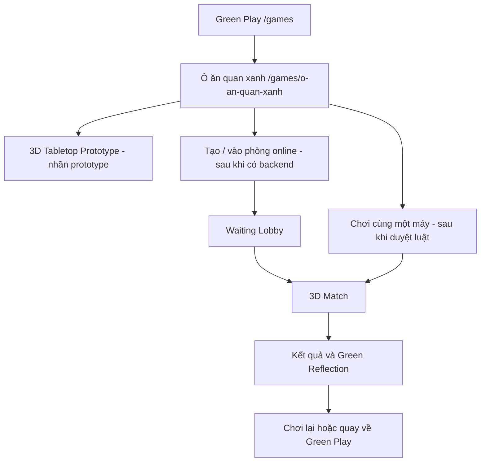

# BR-GAME-001 — Ô ăn quan xanh 3D · Mini PRD / Game Design Document

**Phiên bản:** 0.1 — 20/11/2026
**Trạng thái:** `PROPOSED / DESIGN-READY`, **KHÔNG** xác nhận luật chơi chính thức hay tính năng đã build
**Sản phẩm:** Brainroot 2.0 → Green Play
**Ưu tiên người dùng:** Desktop-first; mobile đọc được và thao tác cơ bản, thiết bị không hỗ trợ WebGL có đường thay thế tiếp cận.
**Quyết định chủ dự án đã nêu:** Muốn trải nghiệm bàn Ô ăn quan **3D thực**, được biến tấu thẩm mỹ/giáo dục theo Brainroot, **có khả năng chơi online với bạn bè**.
**Kỷ luật phạm vi:** Không tự mở/đóng `OQ-08`; không biến proposal này thành game chính thức khi luật chưa được đội duyệt.

**Trạng thái khi nhập tài liệu:** Chưa dựng prototype 3D và chưa có backend multiplayer. `BR-T023` chỉ theo dõi Slice A sau khi owner duyệt phạm vi. R0 vẫn ưu tiên một vòng chơi giáo dục end-to-end theo PRD, Roadmap và `OQ-01`. `BR-T004` và `BR-T006` giữ phạm vi hiện hành.

## 0. Nguồn và mức độ xác nhận

| Mục | Nguồn | Mức xác nhận |
|---|---|---|
| Sứ mệnh, 4 khu vực Brainroot, guest access, bảo vệ asset trả phí | `docs/PRD.md`, `AGENTS.md` trong repo | `VERIFIED` từ tài liệu hiện hành |
| Kho Ô ăn quan xanh có 5 chủ đề và 3 cấp độ; mô tả 100 thẻ | `docs/GAME_SPEC.md` và nhóm cung cấp | `VERIFIED` theo hồ sơ; **100 thẻ cần đối soát khi import** |
| Luật bàn số, cơ chế ăn/chấm điểm, thời gian, gắn chủ đề | `planning/OPEN_QUESTIONS.md` → `OQ-08` | `OPEN / BLOCKED` |
| 3D tabletop, phòng online 2 người, Green micro-learning | Ý tưởng người dùng + tài liệu này | `PROPOSED`; chưa được đội thiết kế game phê duyệt |
| Ảnh `VIS-008` (hình bàn trên nền vườn) | Artwork concept từ BR-T022 | **Chỉ minh họa marketing**, không phải geometry/model 3D hay bàn chính thức |
| Cấp quyền sử dụng Brainie, Rootie và nội dung Canva khi phát hành | `BR-T002` | `BLOCKED` cho public/commercial release |
| R0 ưu tiên 1 game end-to-end | `docs/PRD.md`, `planning/ROADMAP.md`, `BR-T006` | Chưa tự chuyển P0 playable sang Ô ăn quan; `OQ-01` vẫn OPEN |

## 1. Product vision

**Working title:** Ô ăn quan xanh 3D — *Green Seed Tabletop* (không đổi thương hiệu chính thức nếu nhóm chưa duyệt).
**Pitch:** Trò Ô ăn quan dân gian Việt Nam được đưa vào một bàn chơi 3D thu nhỏ trong khu vườn Brainroot. Hai người có thể đối đầu bằng chiến thuật quen thuộc và cùng khám phá kiến thức/hành động xanh qua những khoảnh khắc tự nhiên, không bị quiz ngắt nhịp liên tục.

**Trụ cột:**
1. **Cultural core:** Giữ cấu trúc nhận diện Ô ăn quan; không tạo game khác đội lốt tên Ô ăn quan.
2. **Tactile 3D:** Bàn và quân có hình khối thật, góc nhìn camera 3/4, ánh sáng/bóng đổ, animation rải và thu quân.
3. **Green learning:** Nội dung có nguồn, phân biệt kiến thức và gợi ý hành động; không tùy tiện thêm cơ chế thưởng phạt môi trường ảnh hưởng luật.
4. **Social play:** Có phòng riêng và hai người cùng chơi, không yêu cầu đăng ký email/mật khẩu cho khách ở phiên phù hợp.
5. **Inclusive fallback:** Canvas không phải con đường duy nhất để hiểu trạng thái hoặc thực hiện hành động.

## 2. Đối tượng và jobs-to-be-done

- **HS/SV:** Muốn một ván chơi có tính chiến thuật, đồ họa hấp dẫn và thêm kiến thức về xanh mà không bị ép đọc nhiều.
- **Bạn bè từ xa:** Muốn tạo phòng, gửi mã, vào trận nhanh, không tạo tài khoản chính thức.
- **Giáo viên/CLB:** Muốn giải thích kết quả và gắn hoạt động sau ván với bài học; chế độ lớp học thuộc roadmap, KHÔNG P0.
- **Người dùng bàn phím/công nghệ hỗ trợ:** Cần biết lượt, ô được chọn, số quân, hành động hợp lệ, điểm số bằng DOM và thao tác không phụ thuộc hoàn toàn chuột/3D.

## 3. Phạm vi và thứ tự build

### Slice A — 3D Interaction Prototype (sau khi owner duyệt phạm vi; không cần `OQ-08` RESOLVED)
- Dùng preview nội bộ tách riêng trong BR-T023. Mọi route thực trong thư viện theo phạm vi và gate của BR-T004.
- Một bàn 3D có **2 hốc đầu lớn và 10 hốc nhỏ** là **bố cục nhận diện trực quan ĐỀ XUẤT**, chờ OQ-08 trước khi gắn logic chính thức.
- 3D mesh thật cho mặt bàn, hốc, quân; camera orthographic/isometric 3/4 cố định, góc nghiêng nhẹ; góc nhìn không tự xoay vô tận.
- Chọn ô bằng click hoặc DOM điều khiển; highlight, số quân, animation bốc/rải **minh họa sandbox**, có thể reset.
- Bảng trạng thái HTML ở cạnh canvas: 2 người, ô đang chọn, log mô tả tương tác.
- Camera và board responsive ở desktop; fallback mô tả bàn/ô có thể truy cập bằng bàn phím khi WebGL không có.
- **Không có điểm thắng, ăn quân “chính thức”, phát câu hỏi ngẫu nhiên, room online giả hoặc lưu kết quả giả.**

### Slice B — Local Gameplay (chỉ sau khi OQ-08 được duyệt)
- Game engine TypeScript thuần (không Three/R3F), `initializeGame`, `getLegalMoves`, `applyMove`, `resolveTurn`, `score`, `getWinner` theo **bản luật và test fixtures do nhóm duyệt**.
- Local 2 người pass-and-play, điều hướng/nhấn phím tương đương canvas, log có thể replay deterministic.
- Thao tác đổi lượt → animate quân → bảng kết quả trên DOM → rematch.
- Không thêm power-up, ô “mưa lớn” đổi luật, trừ lượt “lãng phí điện” trong Slice B.

### Slice C — Online Private Room (sau engine đã kiểm chứng và phê duyệt backend)
- Tạo phòng riêng 2 người, tham gia bằng mã/link, trạng thái `waiting` → `ready` → `playing` → `completed`.
- Server kiểm tra quyền thành viên, lượt, phiên bản state và luật; lưu nước đi atomically; hai client chỉ gửi **ý định nước đi**.
- Nhận bản cập nhật qua realtime; cơ chế reconnect/refresh sync snapshot; ready/rematch; xử lý rời phòng.
- Không cần public matchmaking/chat/rank/voice/cộng đồng tài khoản ở giai đoạn này.

### Slice D — Green Learning Overlay (sau khi BR-T005 có nội dung được duyệt)
- Chọn **một trong năm chủ đề** trước ván; skin/gợi ý hành động gắn chủ đề; chưa sửa luật nền.
- Không ép đọc popup giữa mỗi lượt. Ưu tiên thẻ ngắn **sau ván** hoặc khi người chơi chủ động mở bảng khám phá.
- Một fact hoặc action phải có `sourceId`, nội dung được duyệt, và lựa chọn `Bỏ qua` không bị trừ điểm.

### Không làm ở MVP
- Thế giới 3D mở, nhân vật đi bộ, AI bot phức tạp, VR, giao dịch/tài khoản trả phí, voice chat, hệ thống gian lận quy mô lớn, leaderboard công khai, class mode có phân tích học sinh, nhiều chủ đề sửa luật, avatar cá nhân có dữ liệu nhạy cảm.

## 4. Luật chơi: quyết định còn mở — OQ-08

**Không được đưa các gợi ý bên dưới vào engine chính thức cho tới khi nhóm ký duyệt.**

| Quyết định | Hướng đề xuất cho prototype | Quyết định nhóm cần xác nhận |
|---|---|---|
| Hình dạng bàn | Hai đầu lớn + hai hàng 5 hốc nhỏ, đủ nhận diện Ô ăn quan | Kích thước/hốc vật lý & ánh xạ chủ đề |
| Phân phối quân ban đầu | Chỉ render quân demo; số lượng **không gắn nhãn luật** | Số dân/quan khởi tạo |
| Chọn ô và chiều rải | UI hỗ trợ chọn ô/direction; không hợp thức hóa bước đi | Ai được chọn ô nào, hai chiều, điều kiện hợp lệ |
| Ăn quân/lặp lượt | **Không triển khai quy tắc thực tế trước duyệt** | Điều kiện ăn, rải tiếp, kết thúc lượt, hết quân |
| Điểm số | Chưa chấm ở prototype | Trọng số quan/dân, vay quân, khi nào kết thúc, hòa |
| Kiến thức xanh | Màn tổng kết độc lập luật | Ánh xạ 5 chủ đề x 3 mức, thời điểm xuất hiện |
| Online | Hai người riêng tư, theo lượt | Turn timer, disconnect grace, quyền host, rematch |

**Bộ hồ sơ cần nhóm cung cấp:** 1 trang luật, 3 ván mẫu có từng nước, các tình huống rìa (hốc trống/ăn liên hoàn/hết quân/hòa), rubric điểm, một bảng đáp án kèm nguồn cho ≥5 item nếu áp dụng giáo dục. Sau khi duyệt, tạo `docs/decisions/ADR-OQ-08-...md` và test cases bảo toàn chính sách.

## 5. Hành trình UX & screen map



**Các màn:**

| Màn | Thành phần chính | Trạng thái bắt buộc |
|---|---|---|
| Product Detail | Hero ảnh sản phẩm; bản 3D được giới thiệu như định hướng nếu chưa hoạt động; luật/chủ đề; CTA thật | `concept / prototype / available / unavailable` |
| 3D Tabletop | Scene canvas, hướng dẫn camera, HUD lượt và điểm, danh sách hốc DOM, Help | `loading / ready / selected / animating / unsupported / error` |
| Mode Selection | Local, Tạo phòng, Vào phòng | Chỉ mở những mode hoạt động thực tế; nút unavailable bị disable + lý do |
| Lobby | Room code, copy/share, nickname hiển thị ngắn, người tham gia, Ready, Exit | `waiting / ready / joined / disconnected / expired / full` |
| Online Match | Bàn 3D, current turn, connection status, last move, resign/exit, game log | `playing / resyncing / reconnecting / opponent_left / completed` |
| Result | Điểm/chiến thắng theo rubric đã duyệt, rematch, hành động xanh với nguồn | `win / lose / draw / cancelled` |

**Product copy:** Không gọi VIS-008 là board model cuối cùng. Trước lúc có sản phẩm chơi thật, CTA là “Xem bản dựng 3D thử nghiệm” hoặc “Đang phát triển” thay vì “Chơi ngay” giả.

## 6. 3D art direction & asset list

- **Thế giới:** Bàn gỗ thủ công xanh-sage/đào đặt trong Green Play Pavilion; glasshouse, cây lá, ánh nắng ấm gợi Hero V4. Tâm trải nghiệm là **bàn chơi**, không phải background nhiều chi tiết.
- **Camera:** Orthographic 3/4, fixed; có thể zoom nhẹ với giới hạn và nút “Đặt lại góc nhìn”, không bắt buộc orbit; không phụ thuộc raycasting để chơi.
- **Palette:** `#E79A7C`, `#A6C6B6`, `#F8F3E9`, `#263B31`, tiêu đề `#63894C`, highlights đủ tương phản.
- **Geometry:** Mặt bàn có độ dày và hốc thật, đơn giản hóa để giữ FPS; quân hạt 3D với 2–3 biến thể màu, **không dùng sprite 2D làm gameplay chính**.
- **Asset IDs mới đề xuất (không đè VIS-008):** `GAME3D-001` board model, `GAME3D-002` seed/piece meshes, `GAME3D-003` table/pedestal, `GAME3D-004` garden lighting environment, `GAME3D-005` HUD SVG icons, `GAME3D-006` optional approved mascot overlay cutouts.
- **Pipeline:** Prototype dùng meshes procedural; khi art direction đạt thì có thể thay `GAME3D-001` bằng mô hình Blender/GLB tối ưu mà **không đổi game logic**. Không cần dựng model phức tạp ở bước đầu.
- **3D animation:** Chọn ô: highlight + lift; đi quân: piece hop/arc ngắn theo thứ tự; ăn quân: thu vào khu đếm; kết thúc: celebration nhỏ, không flash mạnh. Có `prefers-reduced-motion` với cập nhật tức thì.
- **Không tạo bản quyền giả:** VIS-006 là môi trường, VIS-008 là **ảnh concept marketing**, các linh vật gốc chỉ dùng khi nhóm cấp quyền, không sinh lại hình ảnh nhân vật để ghép vào model.

## 7. Kiến trúc frontend và game engine

**Stack kế thừa:** React 19, TypeScript strict, Vite 7, CSS module hóa. Thư viện đề xuất cho 3D: `three` + `@react-three/fiber` (stable theo compatibility tại thời điểm cài), `@react-three/drei` chỉ khi thực sự cần. Không cài alpha/latest tự động. Router theo đặc tả `BR-T004`.

**Thư mục đề xuất, chưa được tạo trong repo:**
```text
src/features/oanquan/
  model/          # types, schemas, config, OQ-08 ruleset
  engine/         # pure functions, deterministic state transitions
  engine/tests/   # rule fixtures / turn resolution
  components/     # BoardCanvas, PitMesh, SeedInstanced, GameHUD, AccessibleBoard
  animation/      # presentation-only transitions
  multiplayer/    # adapter interface, snapshot, reconnect, room flows
  pages/          # Product detail / prototype / match
  data/           # approved green content refs only
```

**Engine contract — đề xuất:**
```ts
type PlayerId = 'p1' | 'p2';
type MatchPhase = 'setup' | 'playing' | 'completed';
type RoomStatus = 'waiting' | 'ready' | 'playing' | 'completed' | 'expired';

interface MatchState {
  matchId: string;
  rulesetVersion: string;
  revision: number; // tăng một lần cho mỗi nước được server chấp nhận
  phase: MatchPhase;
  currentPlayer: PlayerId;
  pits: ReadonlyArray<number>; // mapping được cấu hình bởi OQ-08
  captured: Record<PlayerId, number>;
  moveHistory: ReadonlyArray<AcceptedMove>;
  winner: PlayerId | 'draw' | null;
}

interface MoveIntent {
  matchId: string;
  expectedRevision: number;
  playerId: PlayerId; // client chỉ đề xuất; SERVER lấy định danh từ session
  pitId: string;
  direction?: 'clockwise' | 'counterclockwise';
  requestId: string; // idempotency
}

interface AcceptedMove {
  revision: number;
  pitId: string;
  events: ReadonlyArray<{ type: string; pitId?: string; count?: number }>;
  resultingStateHash: string;
}
```
- **Điều quan trọng:** `MatchState` không chứa trạng thái WebGL. Game engine chạy được bằng tests/Node và server; renderer chỉ vẽ snapshot/events.
- **Bất biến (sau chốt luật):** tổng quân bảo toàn qua bàn + captured (trừ trường hợp luật được duyệt có biến thiên), `revision` đơn điệu, lượt đúng người, nước bất hợp lệ không đổi state, replay cùng input cho cùng output.
- **Demo không luật:** phép thử chọn ô và rải minh họa sandbox không dùng chung hàm `applyOfficialMove`; đặt tên rõ `prototypeOnly` để tránh ship nhầm.

## 8. Online multiplayer — phương án đề xuất

**Không chọn Firebase/Supabase/hosted server theo cảm tính trước khi chốt `OQ-12` (chi phí/hosting) và `OQ-06` (privacy, người dùng nhỏ tuổi).** Phương án hợp kiến trúc nếu được duyệt: Supabase Postgres + server-side RPC/Edge Function + Realtime private Broadcast; anonymous auth để khách vào phòng không cần tài khoản đăng ký. Realtime là **kênh thông báo**, không phải nguồn sự thật luật chơi.

### Trình tự một nước đi
1. Client có revision `N`, người chơi chọn ô và hướng.
2. Client gửi `MoveIntent` đến endpoint server đã xác thực; không gửi “state cuối” tự tính.
3. Server transaction: kiểm tra room membership, đúng lượt, đúng revision, hợp lệ theo ruleset được duyệt, rồi lưu move + `revision N+1` atomically.
4. Server phát `match.updated` revision `N+1` đến **private channel** của phòng.
5. Hai client lấy/đồng bộ snapshot; animation chỉ phục vụ hiển thị. Nếu miss event hoặc reconnect, fetch snapshot authoritative.
6. Duplicate `requestId` trả về kết quả đã xác nhận, không thực thi 2 lần.

### Minimal schema — đề xuất
- `rooms`: `id`, `code_hash`/protected join code, `status`, `created_at`, `expires_at`, `host_session_id`, `ruleset_version`.
- `room_participants`: `room_id`, `session_id`, `slot`, `display_name` tùy chọn, `last_seen_at`.
- `matches`: `room_id`, `revision`, `snapshot_json`, `current_player`, `phase`, `updated_at`.
- `moves`: `match_id`, `revision`, `actor_session_id`, `request_id` unique, `intent_json`, `accepted_events_json`.
- Constraints: max 2 active player slots; invite code rate-limited + expiry + hash/entropy đủ mạnh; no service key in frontend; private room RLS / endpoint authorization, all writes from trusted server; room retention hạn chế.

### Disconnection & privacy
- Lost socket → UI `Đang kết nối lại` + server snapshot; reconnect trước khi phát nước mới.
- Người thứ ba không xem được private state nếu không được phép; spectator là P2 và opt-in.
- Không công khai real name, không lưu email/địa chỉ/trường học; nickname tùy chọn, lọc ký tự hiển thị, không dùng chat tự do ở MVP.
- Chưa có backend được duyệt thì chỉ hiển thị prototype/local, **không giả nút “Tạo phòng” hoạt động**.

## 9. Giáo dục xanh — nội dung, schema, thời điểm

- 5 chủ đề **đúng hồ sơ**: `sustainable_consumption`, `water`, `energy`, `waste`, `green_spaces`.
- 3 cấp độ: `recognition`, `decision_making`, `problem_solving`.
- Một mẫu item: `{ id, topic, level, kind: 'fact'|'action'|'reflection', prompt, explanation, sourceId, reviewStatus, accessibilityAlternative? }`.
- Chỉ dùng item `reviewStatus='approved'`; không dùng lời giải sinh bởi AI như nguồn khoa học chính thức; không lộ toàn bộ kho thẻ trả phí.
- Trong trận: kiến thức là **optional** và không ảnh hưởng lượt/điểm. Sau trận: tối đa 1–2 ý chính + hành động xanh có thể bỏ qua, kèm nguồn và ngày rà soát.
- Những mechanic kiểu “ô đặc biệt ăn thêm”, “mưa làm mất quân”, “điện lãng phí mất lượt” chỉ là **ideas backlog**, không thuộc MVP và không được cài trước OQ-08.

## 10. Trải nghiệm tương tác & accessibility

- Canvas 3D và **HTML HUD/controls** kết hợp; dùng semantic buttons theo thứ tự hốc, danh sách quân/điểm, `aria-live` thông báo lượt; không dùng canvas raycast là đường duy nhất để chọn ô.
- Bàn phím: Tab đến nhóm hốc, mũi tên chọn, Enter/Space xác nhận, Escape đóng modal; controls focusable, visible focus.
- No default timer; thắng/thua không chỉ báo bằng màu. Không bắt buộc âm thanh/drag; giảm chuyển động phù hợp `prefers-reduced-motion`.
- Khi WebGL unsupported/loss: hiển thị trạng thái, nút reload/reset và bảng tương tác DOM thay thế có thể thao tác được; không biến fallback thành bản game 2D chính.
- Desktop target 1440×900 và 1280×800; mobile 390×844 và 320×740 cần không tràn ngang, cơ bản chọn ô được.
- Theo quyết định đã ghi, Hero H01 có giới hạn WCAG 2.2.2; **không mở rộng ngoại lệ chuyển động vô hạn** sang game 3D.

## 11. Chất lượng kỹ thuật và an toàn vận hành

- 3D scene lazy-loaded khi vào route game; tách khỏi bundle landing; ưu tiên procedural meshes/instancing, ít draw calls, textures tối giản, không ép render liên tục khi nhàn rỗi.
- Target để đo: Desktop trung bình ≥50–60 FPS trên máy thử ghi rõ phần cứng; click response không đợi animation hoàn tất; đo thêm Chrome CPU slowdown/throttling; không khẳng định đạt nếu chưa đo.
- Test unit: turn validation, invariants, edge cases, deterministic replay; không thêm các test luật giả khi OQ-08 chưa duyệt.
- Test online: hai tabs khác session, race duplicate intent, wrong turn, refresh, reconnect, expired room, join wrong code, third user blocked, unauthorized update.
- Test UX: focus, Tab/Enter/Escape, screen-reader smoke, mobile 390/320, zoom 200%, reduced-motion, WebGL-failure state.
- Security: rate limit room join/creation/move; server-only rule validation; no privileged secrets/browser; RLS/private realtime; log ẩn danh tối thiểu.
- Evidence: screenshot/video desktop 3D, GIF ngắn interaction, QA log và commit/PR; mọi trạng thái test ghi `PASS/FAIL/NOT RUN` trung thực.

## 12. Phân chia milestone & Definition of Done

| Task đề xuất | Phạm vi | Kết quả kiểm chứng | Blocker |
|---|---|---|---|
| `BR-GAME-001-S0` | Owner/leader xem spec, chốt prototype scope; giữ OQ-08 OPEN | Spec acknowledged, không đổi PRD R0 ngầm | Chưa duyệt scope |
| `BR-GAME-001-S1` | 3D board interaction sandbox | 3D thật, chọn ô bằng canvas và DOM, UI responsive, QA; **không claim playable luật** | Chưa cần OQ-08 |
| `BR-GAME-001-S2` | Ruleset ADR + deterministic engine + local play | Fixtures do team ký duyệt, local full match, score, reset/replay | `OQ-08` |
| `BR-GAME-001-S3` | Private room backend + 2-player sync | 2 browsers join, moves server-validated, reconnect, privacy review | `OQ-06`, `OQ-12`, S2 |
| `BR-GAME-001-S4` | Green content integration + final polish | Content approved, sources, post-match learning, contrast/perf E2E | `BR-T005`, S2/S3 |

**Không tự chuyển** `BR-T006` sang game này; `BR-T006` vẫn ưu tiên một vòng chơi giáo dục end-to-end; Fact–Act là một phương án trong `OQ-01`. Nhánh game 3D có thể tiến hành thành **prototype song song nhỏ**, không chiếm chỗ của demo R0 thiết yếu.

### Acceptance gate S1 (sau khi duyệt phạm vi S0)
- [ ] Một route demo/preview nội bộ có bàn 3D thật (mesh depth, shadow, camera 3/4).
- [ ] Đúng bộ màu, kiểu chữ và cảm giác Green Play; artwork có quyền sử dụng hợp lệ.
- [ ] Ít nhất 12 vùng hốc được thể hiện theo **bố cục đề xuất**, có thể chọn và highlight.
- [ ] Có phiên bản chọn ô HTML, trạng thái hiện bằng chữ.
- [ ] Reset khôi phục trạng thái sandbox, không phát hiện console error.
- [ ] Bật giảm chuyển động làm animation tức thời.
- [ ] 1440px và 390px có screenshot, không tràn ngang; 320px là smoke test.
- [ ] Không gắn giả “Chơi online”, “Đã có luật chính thức”, “Hoàn thành bài học”.
- [ ] Codex typecheck, build, tests hiện có, Playwright smoke PASS hoặc ghi blocker có chứng cứ.

### Acceptance gate S3 (online)
- [ ] 2 session độc lập tham gia cùng phòng, đúng 2 slots.
- [ ] Không thể đi hộ người khác và không thể gửi 2 nước cùng revision.
- [ ] Server từ chối intent sai/room outsider; duplicate request không nhân đôi lượt.
- [ ] Refresh một client hiển thị cùng server state; reconnect đồng bộ bản mới nhất.
- [ ] Room expiry, player disconnect, rematch có kịch bản rõ; private state không bị truy cập bởi outsider.
- [ ] Không cần email/password để xem và vào chơi thử khi được phép; không thu PII không cần thiết.

## 13. Các quyết định nhóm phải chốt (không để agent tự đoán)

1. `OQ-08`: luật số hóa chi tiết, cách quy đổi điểm và kết thúc trận.
2. `OQ-01`: game nào đại diện bản R0 playable bắt buộc — giữ Fact–Act hay đổi sang Ô ăn quan xanh? **Chờ leader/team chốt OQ-01.**
3. `OQ-12`: backend/hosting/chi phí cho private online rooms và ai sở hữu tài khoản.
4. `OQ-06`: guest privacy và xử lý dữ liệu người dùng trẻ tuổi.
5. Bản quyền model/ảnh minh họa/mascot để phát hành.
6. Tính giáo dục có ảnh hưởng điểm hay chỉ micro-learning sau trận? **Mặc định không ảnh hưởng luật.**

## 14. Technical references (documentation, không phải chứng nhận đang dùng)

- R3F: https://r3f.docs.pmnd.rs/getting-started/introduction
- Supabase Realtime private channel authorization: https://supabase.com/docs/guides/realtime/authorization
- Supabase Anonymous Sign-Ins: https://supabase.com/docs/guides/auth/auth-anonymous
- Brainroot repo files: `docs/PRD.md`, `docs/GAME_SPEC.md`, `planning/OPEN_QUESTIONS.md`, `planning/ROADMAP.md`, `planning/TASKS.md`, `docs/UX_UI_MASTER_BLUEPRINT.md`.

**Kết luận phát triển:** Bắt đầu **S1 — 3D tabletop prototype** trên branch riêng; triển khai local rule engine và online rooms lần lượt sau khi có quyết định. Không đánh đồng concept 2D VIS-008 với board 3D thật.
