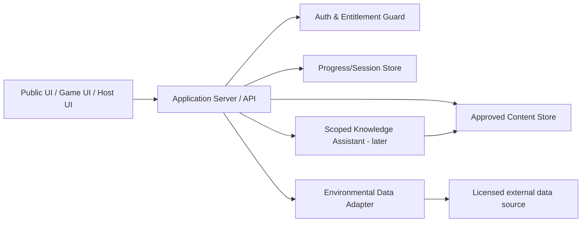

# Technical Architecture — Proposed, not implemented

## Proposed baseline stack
- Next.js + TypeScript + Tailwind design tokens; React component model and SSR/SSG as appropriate.
- Postgres (e.g. Supabase) **only when** auth/progress/realtime is required. For R0 use approved JSON/TS content plus minimal hosting if enough.
- Auth options (Supabase Auth or comparable) remain *proposed*. Validate session management, privacy for minors, RLS and server-side role guards before launching accounts.
- Realtime room: Supabase Realtime / WebSocket service as warranted in R2; fallback to in-person host-controlled demo where necessary. Avoid building websockets before the requirement is approved.
- Game content module independent of visual UI: domain models `ContentPack`, `Question`, `GameSession`, `GameResult`, `Entitlement`.

## Logical architecture

## Module boundaries
1. `src/features/brand/` — landing/about.
2. `src/features/games/` — game engines/adapters, types, result evaluator.
3. `src/features/content/` — published content and citations.
4. `src/features/challenges/` — challenge state and reflection.
5. `src/features/auth/` — session/roles/entitlement.
6. `src/features/rooms/` — host and participant sessions.
7. `src/features/environment/` — AQI providers and data provenance.
8. `src/features/assistant/` — bounded FAQ/RAG *later*.
9. `src/shared/ui/` — design tokens, components and mascot assets.

**Các đường dẫn trên là phác thảo**, chưa phải cấu trúc repo được tạo sẵn.

## Data provenance and API boundaries
- `EnvironmentReading` phải lưu `provider`, `station_or_model`, `measurement_or_forecast`, `standard`, `unit`, `observed_at`, `retrieved_at`, `license`, `stale`.
- Khi dữ liệu thiếu: hiển thị `Unavailable` và bài học tổng quát, không nội suy số AQI giả.
- Nếu truy cập vị trí, dùng explicit consent; không lưu tọa độ chính xác mặc định.
- Server-side caching, throttling, retries, timeout; giới hạn chi phí/bảo vệ API secret.

## Deployment/recovery (when infra is approved)
- `main` chỉ merge sau review và kiểm thử; preview builds theo feature branch nếu có.
- `.env.example` public placeholder; `.env.local` gitignored; secret rotation runbook.
- Trước mỗi deploy: npm scripts thực tế (`lint`, `typecheck`, `test`, `build`) + smoke play flow + smoke guest access.
- Rollback = redeploy commit/tag trước, không tự migrate production destructive.

## Open architecture decisions
- Auth/DB provider, deployment platform, content editorial tooling, AI provider, realtime provider, commercial license terms, cost ceiling phải được owner phê duyệt. Xem `planning/OPEN_QUESTIONS.md`.
