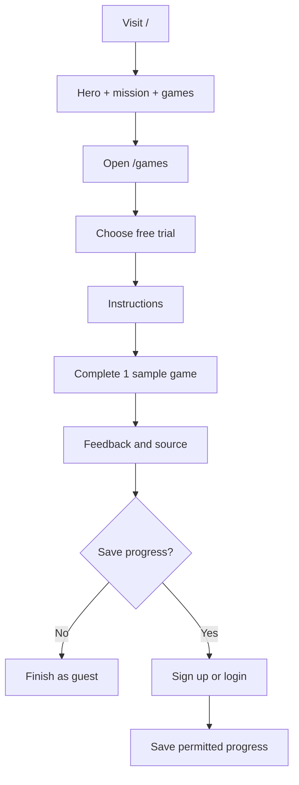
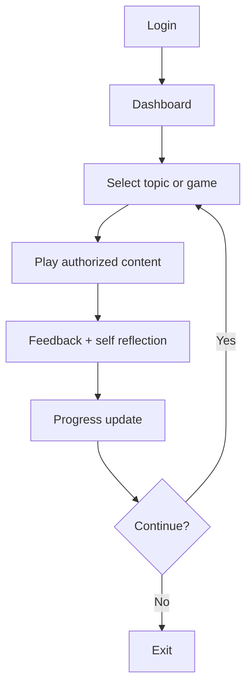
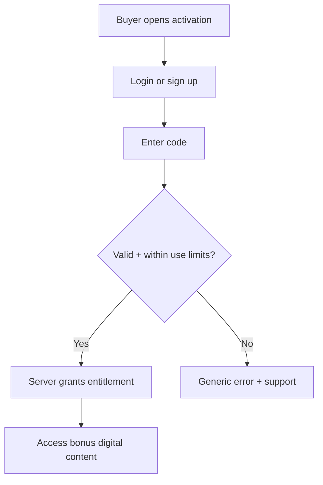
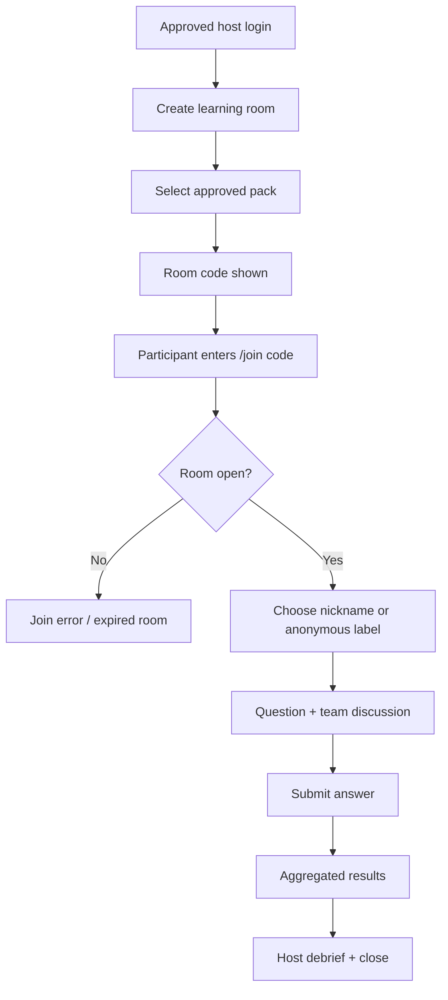
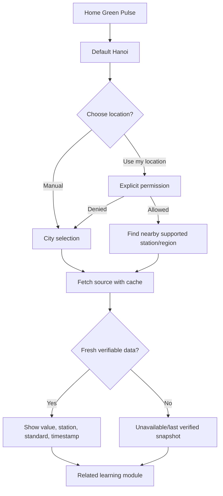
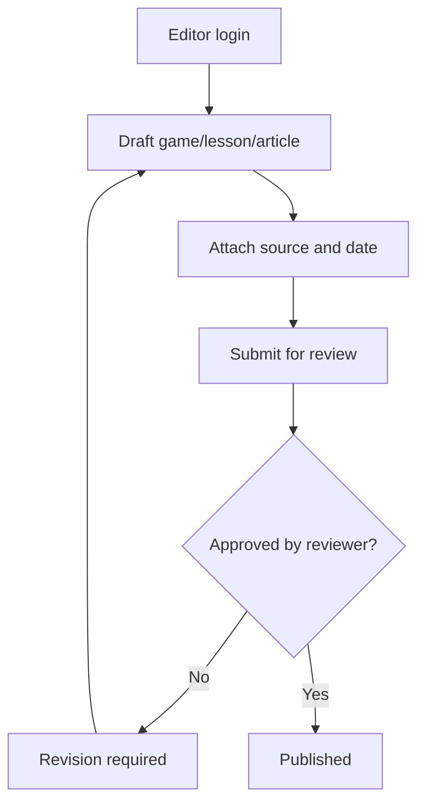

# User Flows — Brainroot 2.0

**v0.1 proposed** · Paths minh họa, chỉ trở thành route thực tế khi source code được tạo.

## Navigation principles
- Không yêu cầu login để khám phá, đọc thông tin và chơi thử.
- Đăng nhập chỉ khi cần lưu trạng thái hoặc mở quyền paid/host/admin.
- Mỗi trò chơi phải có trạng thái rõ và khả năng thoát/về library.
- Từ nguồn nội dung (fact, AQI) có đường nối sang game/thử thách phù hợp, không ép sử dụng.

## UF-01 — Public discovery → trial → signup (R0)

**Error/edge:** nội dung unavailable → thông báo + gợi ý game khác; refresh giữa ván → hỏi bắt đầu lại/khôi phục local session (không hứa server save khi chưa có).
**AC:** guest hoàn thành mà không lộ dữ liệu paid; có hướng dẫn dễ hiểu, keyboard navigation.

## UF-02 — Returning member → choose game → progress (R1)

**Error:** expired session → re-auth then return safe point; no entitlement → upsell information without exposing restricted question payload.

## UF-03 — Physical buyer → activate content (R1/R3)

**Security:** không gửi toàn bộ danh sách mã sang client; chỉ hash/record server; rate limit và chống dò mã.

## UF-04 — Teacher/CLB host → participant join without accounts (R2 candidate)

**Privacy:** không bắt buộc danh tính học sinh, không công khai câu trả lời gắn PII; nickname lọc ký tự có hại; người tổ chức có quyền kết thúc phiên.
**Degraded flow:** mất mạng → trạng thái reconnect, no double submit, hết thời gian trả lời chỉ khi host chọn.

## UF-05 — Green Pulse environmental context (P1/P3, only if data/license validated)

**No GPS persistence by default.** Không gọi dự báo như đo tại trạm. Không hiển thị số liệu giả trong production.

## UF-06 — Editor → review → publish

**AC:** unpublished data không tới client public; quyền editor không mặc định được quyền quản trị mã mua hàng.

## Critical cross-cutting states
- Mobile with low bandwidth, expired auth, offline mode where possible, no JS/API failure fallback.
- Keyboard only / reduced motion / screen reader; no game requires drag-only or sound-only interactions.
- Invalid/expired code, already redeemed, rate limited, closed room, deleted content, unsaved progress, service unavailable.
- Parent/guardian and minor privacy considerations where relevant; no public collection of student photos or precise GPS.

## First-time user success definition
Người lần đầu vào website có thể hiểu Brainroot làm gì trong 10–20 giây (mục tiêu UX cần thử nghiệm), tìm và bắt đầu một trò chơi thử, kết thúc, hiểu kiến thức/nguồn liên quan, và tự chọn có đăng nhập hay không.
